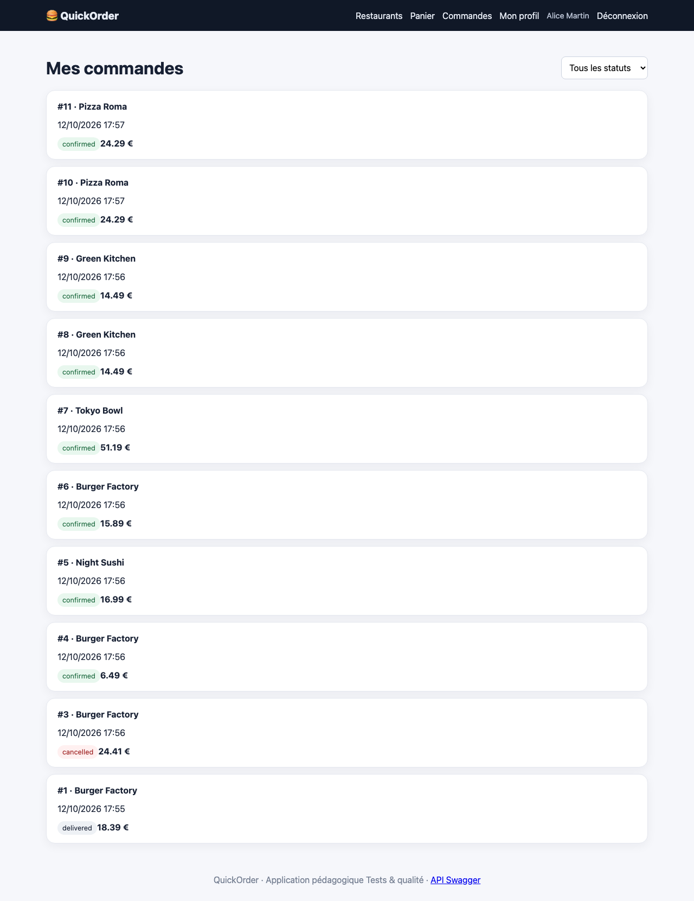
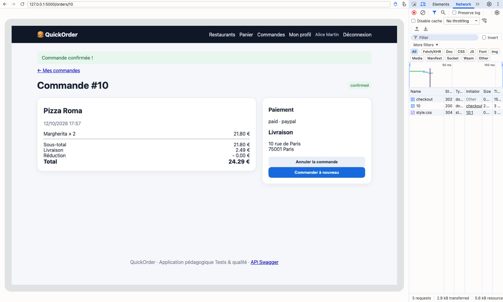

# BUG-01 Un paiement PayPal crée deux commandes identiques

| Champ | Contenu |
|---|---|
| Titre | Un paiement PayPal crée deux commandes identiques. |
| Contexte | QuickOrder V3.1 en local (Docker), Chromium sur macOS, compte alice@example.com. |
| Préconditions | Panier vide, Alice a 8 commandes dans son historique. |
| Étapes | 1. Ajouter 2 Margherita chez Pizza Roma. 2. Aller au checkout et choisir PayPal. 3. Cliquer une seule fois sur Confirmer (24,29 €). 4. Ouvrir Mes commandes. |
| Résultat attendu | Une seule commande de 24,29 €. |
| Résultat obtenu | Deux commandes identiques sont créées (n°10 et n°11, 24,29 €, même heure) et le stock de Margherita baisse de 4 au lieu de 2. L'onglet Réseau de DevTools ne montre pourtant qu'un seul envoi du formulaire. Même problème avec POST /api/orders et "payment_method": "paypal". |
| Preuves | Capture de Mes commandes, capture DevTools de l'onglet Réseau. |
| Priorité / Sévérité | Priorité haute ; sévérité critique car le client paie deux fois. |
| Cas de test | TC-PAIE-003 |

Les deux commandes dans Mes commandes

Un seul envoi du formulaire dans DevTools

