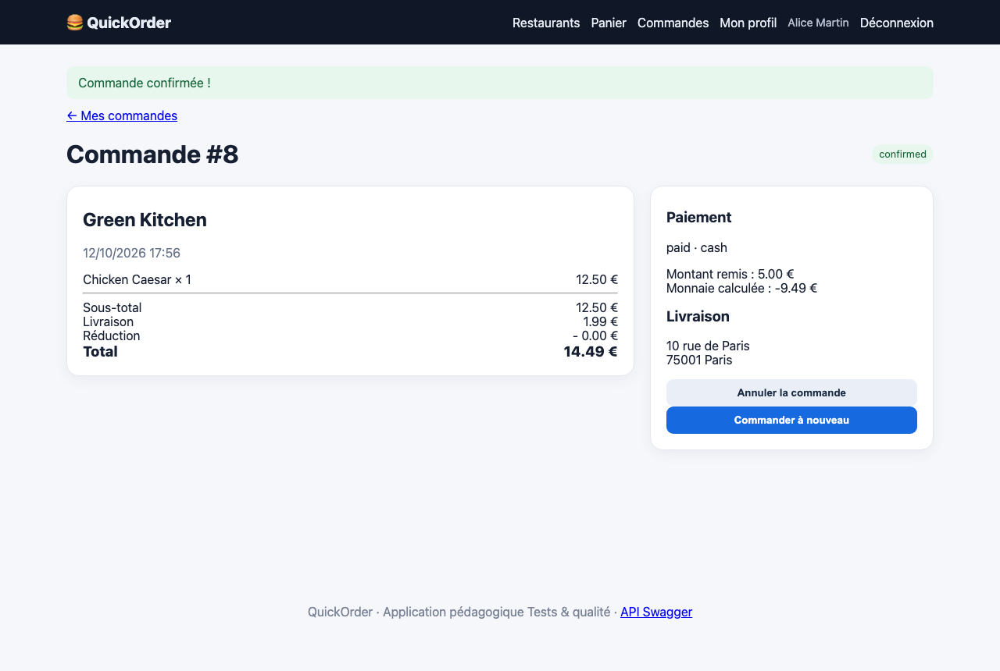
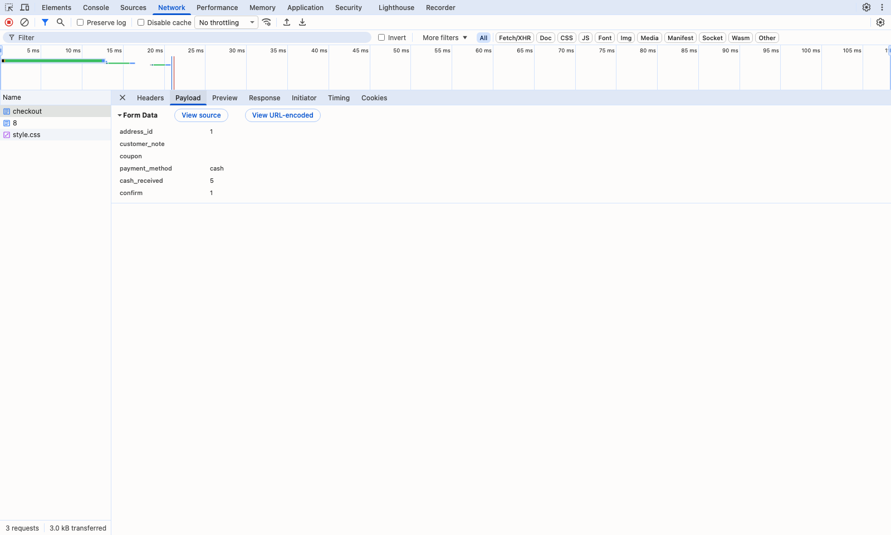

# BUG-02 Une commande en espèces est validée avec un montant inférieur au total

| Champ | Contenu |
|---|---|
| Titre | Une commande en espèces est validée avec un montant inférieur au total. |
| Contexte | QuickOrder V3.1 en local (Docker), Chromium sur macOS, compte alice@example.com. |
| Préconditions | Panier vide. |
| Étapes | 1. Ajouter 1 Chicken Caesar chez Green Kitchen (total 14,49 €). 2. Au checkout, choisir Espèces et saisir 5. 3. Confirmer. |
| Résultat attendu | La commande est refusée avec un message qui indique que le montant est insuffisant. |
| Résultat obtenu | La commande est confirmée avec le statut paid et la monnaie calculée vaut -9,49 €. Par l'API, cash_received à 1 donne aussi une commande payée (change_due -13.89). |
| Preuves | Capture du détail de la commande, capture DevTools de la requête envoyée (cash_received=5). |
| Priorité / Sévérité | Priorité haute ; sévérité critique car la commande passe pour payée alors qu'il manque de l'argent. |
| Cas de test | TC-PAIE-001 |

Commande payée avec une monnaie négative

Données envoyées au serveur

