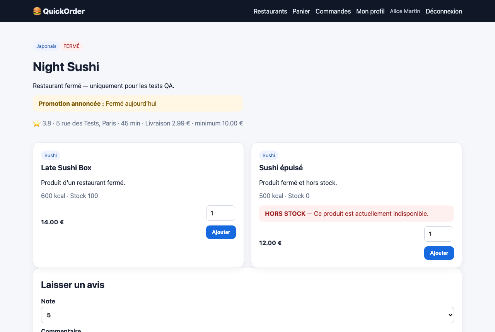
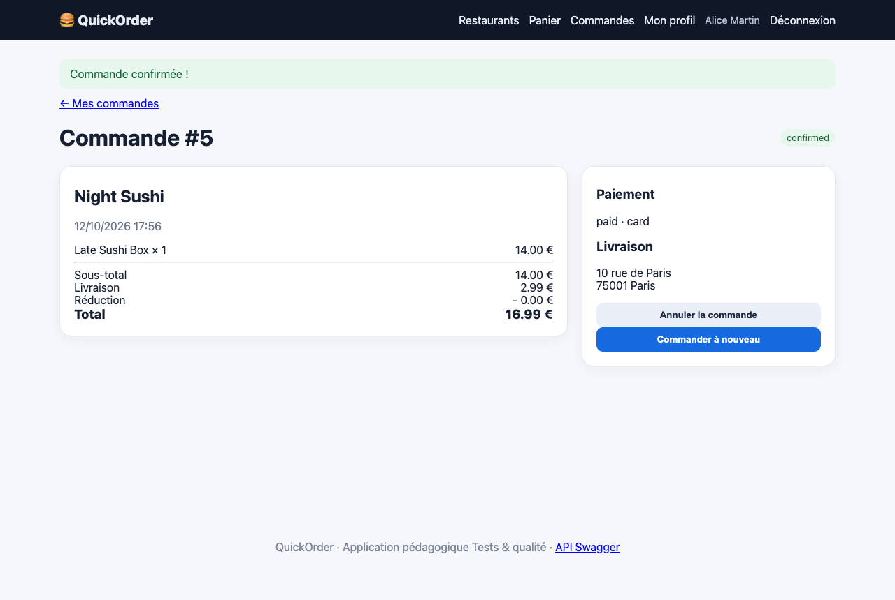

# BUG-03 Un restaurant fermé reçoit quand même des commandes

| Champ | Contenu |
|---|---|
| Titre | Un restaurant fermé reçoit quand même des commandes. |
| Contexte | QuickOrder V3.1 en local (Docker), Chromium sur macOS, compte alice@example.com. |
| Préconditions | Night Sushi est affiché FERMÉ. |
| Étapes | 1. Ouvrir Night Sushi. 2. Ajouter Late Sushi Box. 3. Commander par carte. |
| Résultat attendu | Impossible d'ajouter le produit ou de valider la commande. |
| Résultat obtenu | Le produit est ajouté et la commande n°5 est confirmée et payée. L'API accepte aussi la commande (201). |
| Preuves | Captures de la page du restaurant et de la commande. |
| Priorité / Sévérité | Priorité haute ; sévérité majeure car le client paie une commande qui ne sera pas préparée. |
| Cas de test | TC-CMD-003 |

Night Sushi affiché fermé

Commande confirmée

