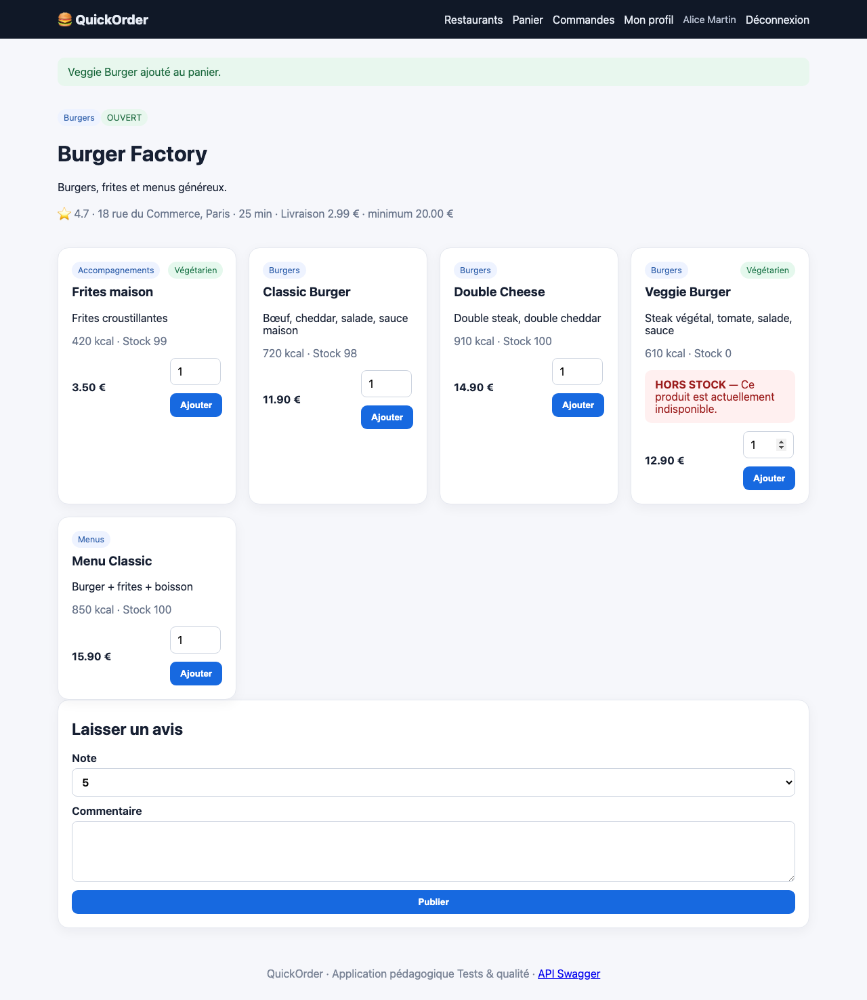
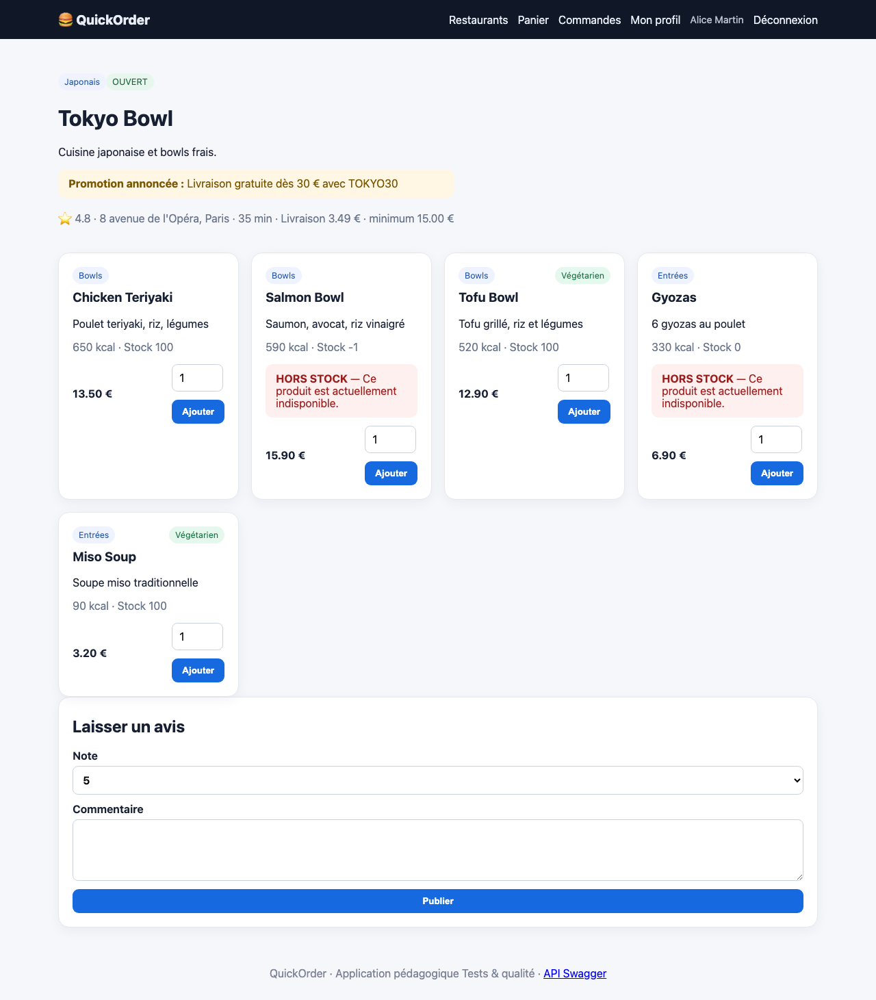

# BUG-04 Les produits épuisés restent commandables et le stock devient négatif

| Champ | Contenu |
|---|---|
| Titre | Les produits épuisés restent commandables et le stock devient négatif. |
| Contexte | QuickOrder V3.1 en local (Docker), Chromium sur macOS, compte alice@example.com. |
| Préconditions | Veggie Burger en stock 0, Salmon Bowl en stock 2. |
| Étapes | 1. Ajouter 1 Veggie Burger (affiché HORS STOCK) et commander. 2. Ajouter 3 Salmon Bowl et commander. 3. Revenir sur la page de Tokyo Bowl. |
| Résultat attendu | Ajout refusé pour un produit épuisé, quantité limitée au stock disponible. |
| Résultat obtenu | Les deux commandes sont confirmées. Le stock du Veggie Burger passe à -1, celui du Salmon Bowl aussi, et la page affiche "Stock -1". |
| Preuves | Captures de l'ajout et du stock négatif. |
| Priorité / Sévérité | Priorité haute ; sévérité majeure car le restaurant reçoit des commandes qu'il ne peut pas servir. |
| Cas de test | TC-STOCK-001, TC-STOCK-002 |

Veggie Burger ajouté alors qu'il est hors stock

Stock -1 affiché sur Tokyo Bowl

