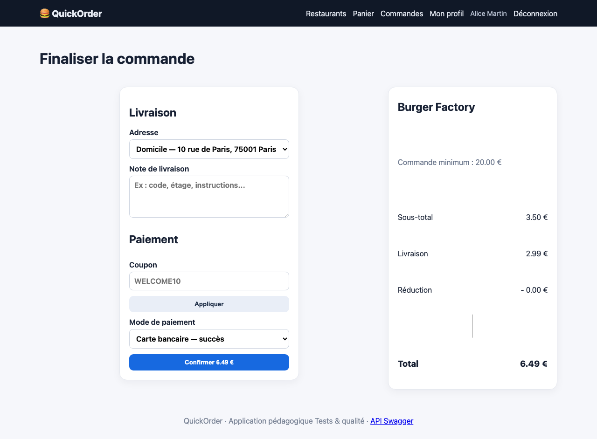
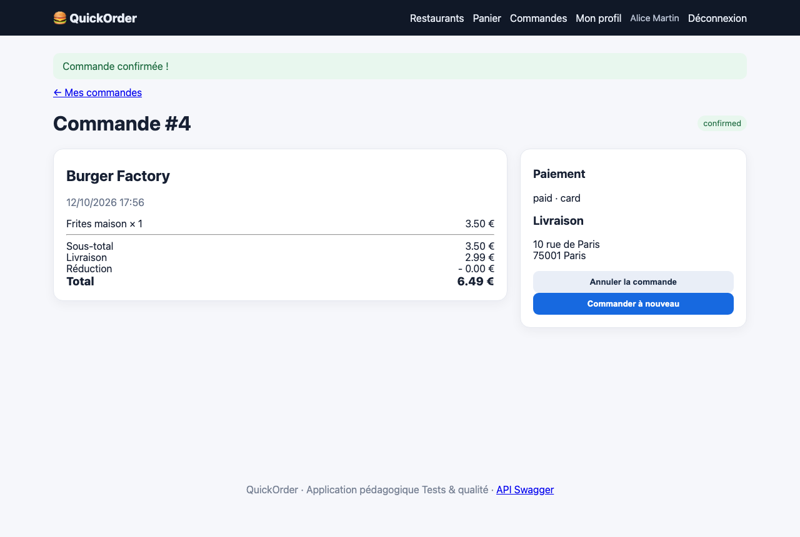

# BUG-05 Le minimum de commande n'est pas appliqué

| Champ | Contenu |
|---|---|
| Titre | Le minimum de commande n'est pas appliqué. |
| Contexte | QuickOrder V3.1 en local (Docker), Chromium sur macOS, compte alice@example.com. |
| Préconditions | Burger Factory demande un minimum de 20 €. |
| Étapes | 1. Ajouter 1 Frites maison (3,50 €). 2. Aller au checkout. 3. Payer par carte. |
| Résultat attendu | La commande est refusée tant que le sous-total est sous 20 €. |
| Résultat obtenu | Le checkout affiche bien "Commande minimum : 20.00 €" mais la commande n°4 à 6,49 € est confirmée. Même chose par l'API. |
| Preuves | Captures du checkout et de la commande. |
| Priorité / Sévérité | Priorité haute ; sévérité majeure car la règle affichée au client n'a aucun effet. |
| Cas de test | TC-CMD-004 |

Checkout à 3,50 € avec le minimum affiché

Commande acceptée

