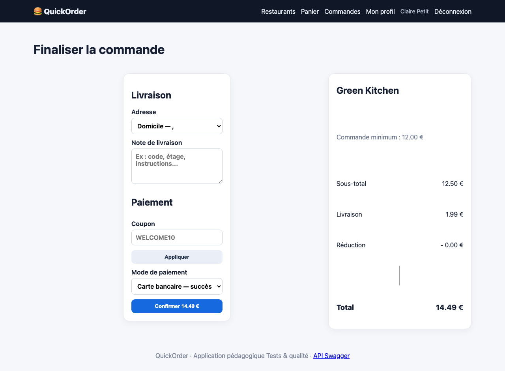
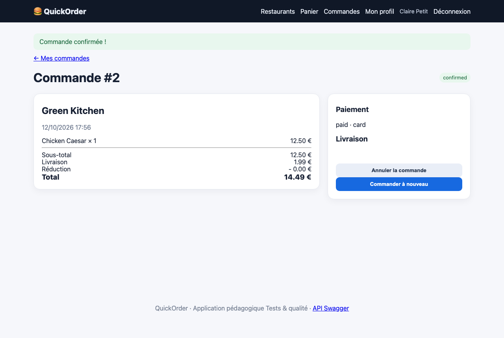

# BUG-06 Un nouveau compte peut commander sans adresse de livraison

| Champ | Contenu |
|---|---|
| Titre | Un nouveau compte peut commander sans adresse de livraison. |
| Contexte | QuickOrder V3.1 en local (Docker), Chromium sur macOS, compte créé pendant le test (claire.petit@example.com). |
| Préconditions | Compte qui vient d'être créé, aucune adresse saisie. |
| Étapes | 1. Créer un compte. 2. Ajouter 1 Chicken Caesar. 3. Aller au checkout et payer par carte. |
| Résultat attendu | Le checkout demande de saisir une adresse complète. |
| Résultat obtenu | L'inscription crée une adresse Domicile vide, sélectionnée par défaut au checkout. La commande n°2 est confirmée et sa partie Livraison est vide. |
| Preuves | Captures du checkout et de la commande. |
| Priorité / Sévérité | Priorité haute ; sévérité majeure car la commande ne peut pas être livrée. |
| Cas de test | TC-CMD-005 |

Adresse vide proposée au checkout

Commande confirmée sans adresse

