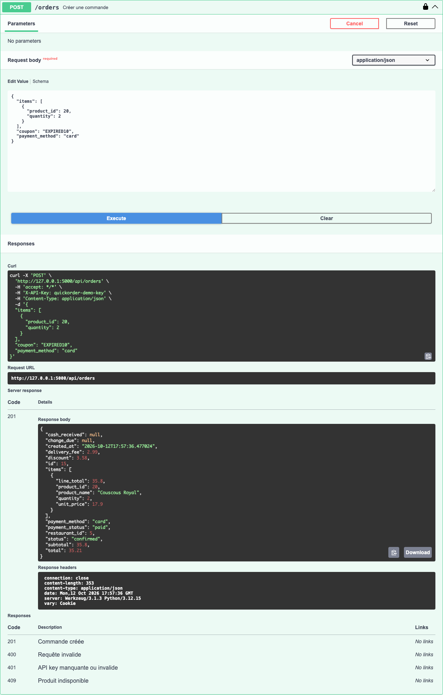

# BUG-07 L'API accepte un coupon expiré lors de la création d'une commande

| Champ | Contenu |
|---|---|
| Titre | L'API accepte un coupon expiré lors de la création d'une commande. |
| Contexte | QuickOrder V3.1 en local (Docker), Swagger UI avec la clé quickorder-demo-key. |
| Préconditions | Le coupon EXPIRED10 a expiré la veille. |
| Étapes | 1. Dans Swagger, cliquer sur Authorize et saisir la clé. 2. Exécuter POST /orders avec {"items": [{"product_id": 20, "quantity": 2}], "coupon": "EXPIRED10", "payment_method": "card"}. |
| Résultat attendu | Le coupon est refusé ou ignoré. |
| Résultat obtenu | Code 201 avec "discount": 3.58. Le site et POST /coupons/validate refusent pourtant ce coupon. |
| Preuves | Capture Swagger de la requête et de la réponse. |
| Priorité / Sévérité | Priorité haute ; sévérité majeure car une promotion terminée reste utilisable. |
| Cas de test | TC-COUPON-004 |

Réponse 201 avec la réduction

