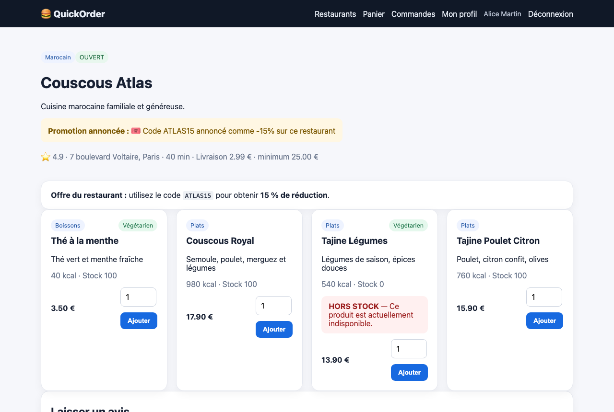
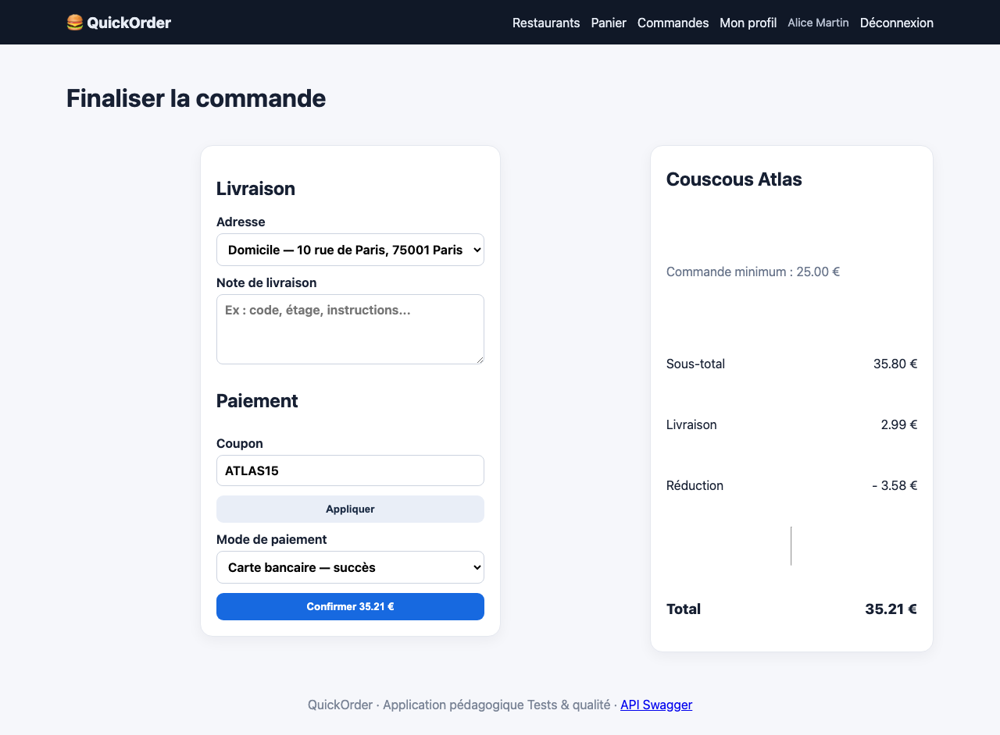

# BUG-08 Le coupon ATLAS15 annoncé à -15 % n'applique que -10 %

| Champ | Contenu |
|---|---|
| Titre | Le coupon ATLAS15 annoncé à -15 % n'applique que -10 %. |
| Contexte | QuickOrder V3.1 en local (Docker), Chromium sur macOS, compte alice@example.com. |
| Préconditions | La page Couscous Atlas annonce 15 % de réduction avec ATLAS15. |
| Étapes | 1. Ajouter 2 Couscous Royal (35,80 €). 2. Appliquer ATLAS15 au checkout. |
| Résultat attendu | Réduction de 5,37 €. |
| Résultat obtenu | Réduction de 3,58 €, soit 10 %. |
| Preuves | Captures de l'offre et du checkout. |
| Priorité / Sévérité | Priorité haute ; sévérité majeure car la promesse faite au client n'est pas tenue. |
| Cas de test | TC-COUPON-003 |

Offre annoncée à 15 %

Réduction appliquée

