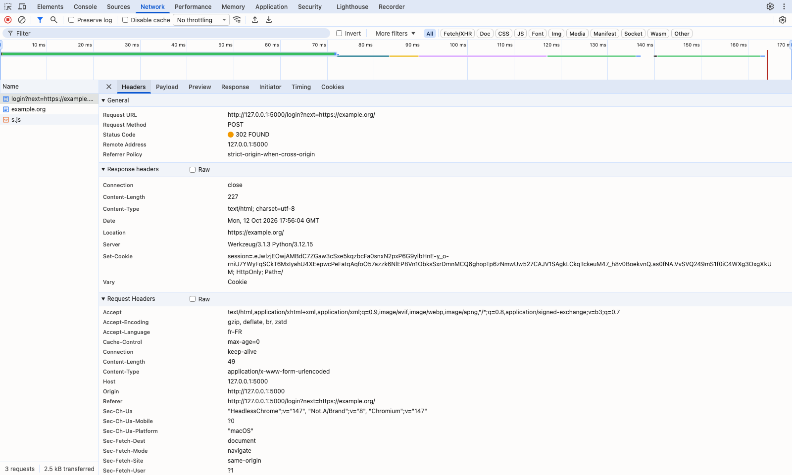

# BUG-09 Après la connexion, le paramètre next peut renvoyer vers un autre site

| Champ | Contenu |
|---|---|
| Titre | Après la connexion, le paramètre next peut renvoyer vers un autre site. |
| Contexte | QuickOrder V3.1 en local (Docker), Chromium sur macOS, compte alice@example.com. |
| Préconditions | Utilisateur déconnecté. |
| Étapes | 1. Ouvrir DevTools sur l'onglet Réseau. 2. Ouvrir http://127.0.0.1:5000/login?next=https://example.org/ 3. Se connecter avec alice@example.com. |
| Résultat attendu | L'utilisateur reste sur QuickOrder. |
| Résultat obtenu | Le serveur répond 302 avec Location: https://example.org/ et le navigateur quitte le site. |
| Preuves | Capture DevTools de la réponse au POST /login. |
| Priorité / Sévérité | Priorité haute ; sévérité majeure car un lien piégé peut envoyer le client vers une fausse page juste après sa connexion. |
| Cas de test | TC-AUTH-004 |

En-tête Location dans DevTools

