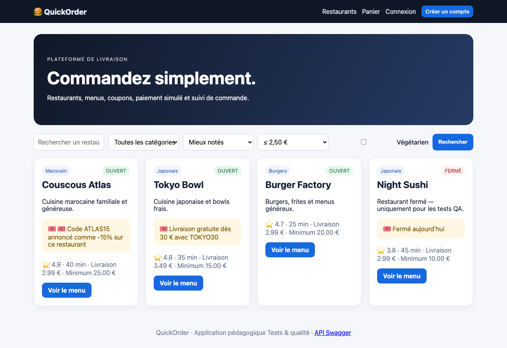

# BUG-10 Le filtre Livraison max affiche les restaurants les plus chers

| Champ | Contenu |
|---|---|
| Titre | Le filtre Livraison max affiche les restaurants les plus chers. |
| Contexte | QuickOrder V3.1 en local (Docker), Chromium sur macOS, sans compte. |
| Préconditions | Aucune. |
| Étapes | 1. Sur l'accueil, choisir 2,50 € dans Livraison max. 2. Cliquer sur Rechercher. |
| Résultat attendu | Green Kitchen (1,99 €) et Pizza Roma (2,49 €). |
| Résultat obtenu | Couscous Atlas, Tokyo Bowl, Burger Factory et Night Sushi s'affichent (2,99 € et 3,49 €). Le filtre est inversé. |
| Preuves | Capture du résultat. |
| Priorité / Sévérité | Priorité moyenne ; sévérité mineure, pas de perte d'argent mais le filtre ne sert à rien. |
| Cas de test | TC-RECH-001 |

Résultat du filtre

