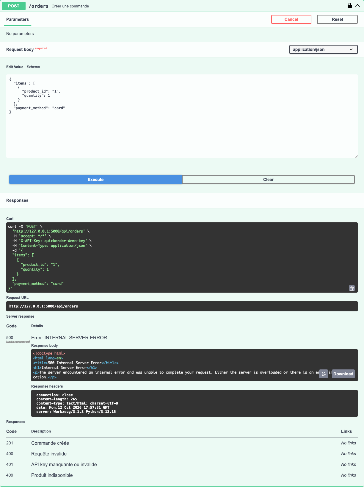

# BUG-11 L'API plante avec une erreur 500 si product_id est envoyé en texte

| Champ | Contenu |
|---|---|
| Titre | L'API plante avec une erreur 500 si product_id est envoyé en texte. |
| Contexte | QuickOrder V3.1 en local (Docker), Swagger UI avec la clé quickorder-demo-key. |
| Préconditions | Aucune. |
| Étapes | 1. Exécuter POST /orders avec {"items": [{"product_id": "1", "quantity": 1}], "payment_method": "card"}. |
| Résultat attendu | Code 400 avec un message d'erreur en JSON. |
| Résultat obtenu | 500 Internal Server Error avec une page HTML. |
| Preuves | Capture Swagger de la réponse. |
| Priorité / Sévérité | Priorité moyenne ; sévérité mineure, l'erreur vient d'une donnée mal saisie mais le serveur ne devrait pas planter. |
| Cas de test | TC-API-004 |

Réponse 500 dans Swagger

